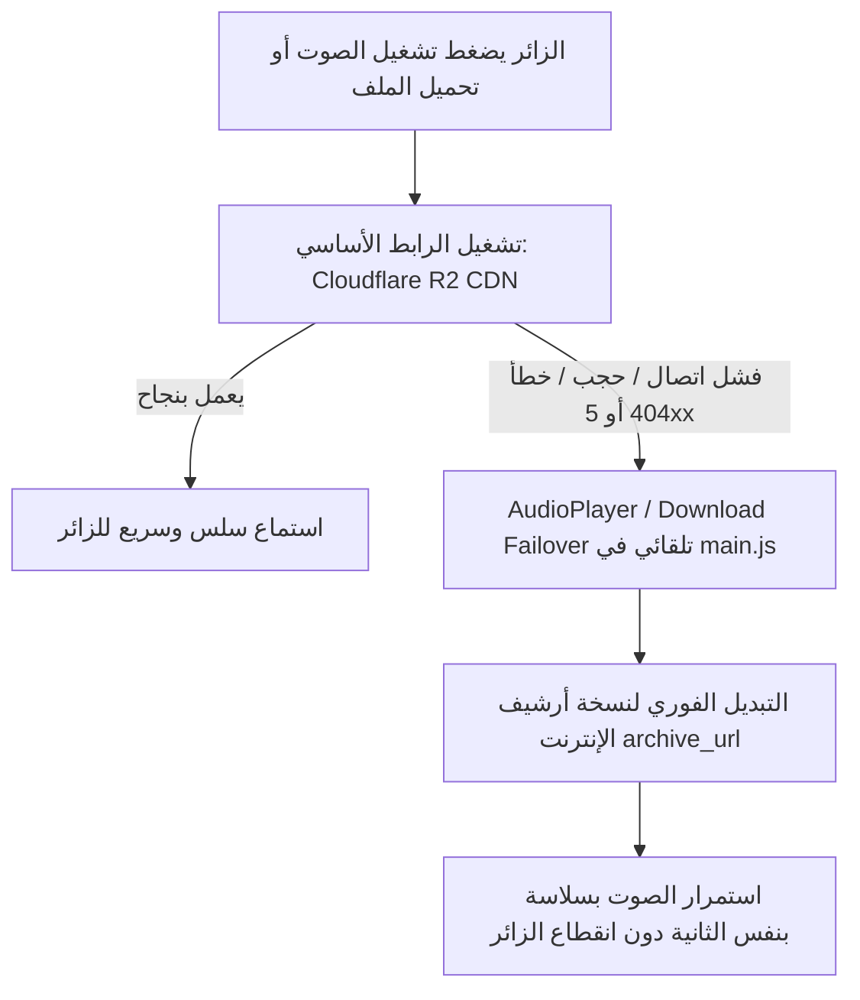

# دليل الانتقال إلى Cloudflare وتفعيل معمارية R2 + Internet Archive المزدوجة

يوثق هذا الدليل خطوات نقل منصة **DSACMS (موقع الشيخ محمد أحمد الهادي)** من Vercel إلى **Cloudflare** (`https://dash.cloudflare.com`)، مع تفصيل البنية المعمارية المعتمدة التي تجمع بين **Cloudflare R2** كخادم تشغيل وتخزين أساسي، و**Internet Archive (IAS3)** كأرشيف دائم ونسخة احتياطية بنظام التبديل التلقائي (Failover).

---

## 1. الفلسفة المعمارية ومطابقة وثيقة المتطلبات (SRS)

### أ. لماذا الجمع بين Cloudflare R2 و Internet Archive؟
| المعيار | الاعتماد على Archive فقط (الوضع السابق) | الاعتماد على R2 فقط | الجمع بين R2 + Internet Archive (المعتمد حالياً) |
| :--- | :--- | :--- | :--- |
| **سرعة التشغيل والاستجابة** | متوسطة إلى بطيئة؛ تعتمد على خوادم كاليفورنيا | فائقة السرعة عبر شبكة Cloudflare Edge العالمية | **فائقة السرعة** من أقرب خادم كاش عالمي للزائر |
| **حد حجم الملف المرفوع** | مقيّد بـ 90 MiB بسبب وسيط Worker | **دون حد 90 MiB** (رفع مباشر Presigned PUT) | **دون حد 90 MiB** مع رفع مباشر للـ R2 |
| **تكلفة نقل البيانات (Egress)** | مجانية | **صفر رسوم (Zero Egress Fees)** | **صفر رسوم نقل نهائياً** |
| **النسخ الاحتياطي (SRS 23.2)** | غير محقق كنسخة منفصلة | غير محقق في تخزين مستقل | **محقق بالكامل أكاديمياً ومعمارياً** |
| **الاستمرارية عند الأعطال (HA)** | نقطة فشل مفردة (SPOF) | نقطة فشل مفردة | **تبديل تلقائي فوري (Seamless Failover)** |

### ب. مطابقة بند وثيقة الـ SRS (البند 23.2: Audio/File Backup)
تنص وثيقة المتطلبات (SRS) في البند **23.2 (Audio/File Backup)** على:
- **Backup Location:** تخزين منفصل تماماً (Separate remote/object storage) ومستقل عن خادم التطبيق.
- **RPO (Recovery Point Objective):** 24 ساعة (مع النسخ التلقائي عند النشر يصبح RPO فعلياً 0 دقيقة).
- **RTO (Recovery Time Objective):** 4 ساعات (مع نظام التبديل التلقائي في `main.js` يصبح RTO ثوانٍ معدودة دون تدخل بشري ودون توقف الموقع).
- **التكلفة:** حتى لو بلغت مكتبة الشيخ 100 غيغابايت (أكثر من 1,500 مادة صوتية وكتاب)، فإن تكلفة تخزين R2 تبلغ نحو **1.35$ شهرياً فقط** مع 0$ لنقل البيانات و0$ للنسخة الاحتياطية على أرشيف الإنترنت.

---

## 2. كيفية عمل نظام التبديل التلقائي (Automatic Failover)



1. **في المشغل الصوتي الموحد (`AudioPlayer` داخل `assets/js/main.js`):**
   - يستقبل المشغل الرابط الأساسي `src` (Cloudflare R2) والرابط الاحتياطي `backupSrc` (Internet Archive).
   - عند وقوع أي خطأ في التحميل (`error` event أو رفض التشغيل)، ينتقل المشغل فوراً إلى المصدر الاحتياطي مع الحفاظ على موضع الاستماع (`currentTime`)، ولا يُعرض أي خطأ للزائر إلا إذا فشل المصدران معاً.
2. **في قارئ الكتب والملفات PDF وأزرار التحميل المباشر:**
   - زُوِّدت أزرار التحميل بخاصية `data-backup-download-url`، فإذا تعذر التحميل من خادم التشغيل الأساسي، يقوم المتصفح تلقائياً بمحاولة التحميل من أرشيف الإنترنت.

---

## 3. خطوات الإعداد في لوحة تحكم Cloudflare (`dash.cloudflare.com`)

### الخطوة الأولى: إنشاء وتكوين مستودع Cloudflare R2
1. ادخل إلى [Cloudflare Dashboard](https://dash.cloudflare.com) واختر **R2** من القائمة الجانبية.
2. اضغط **Create bucket**، وسمِّ المستودع:
   ```text
   dsacms-media
   ```
   (اختر الموقع الجغرافي: **Automatic** أو **WNAM**).
3. اضغط على المستودع `dsacms-media` ثم انتقل إلى تبويب **Settings**:
   - **CORS Policy:** اضغط **Add CORS Policy** وضع الإعداد التالي من ملف `r2-cors-policy.json`:
     ```json
     [
       {
         "AllowedOrigins": [
           "https://*.pages.dev",
           "https://dsacms-frontend.pages.dev",
           "https://mohamedalahadi.com",
           "https://www.mohamedalahadi.com",
           "http://localhost:5500",
           "http://127.0.0.1:5500"
         ],
         "AllowedMethods": ["GET", "HEAD", "PUT"],
         "AllowedHeaders": ["Content-Type", "Range", "Authorization"],
         "ExposeHeaders": ["ETag", "Content-Length", "Accept-Ranges", "Content-Range"],
         "MaxAgeSeconds": 3600
       }
     ]
     ```
   - **Public Access (النطاق العام):**
     - يمكنك تفعيل **R2.dev subdomain** للحصول على رابط عام فوري، أو
     - الأفضل: ربط نطاق مخصص مثل `media.mohamedalahadi.com` عبر خيار **Connect Domain**؛ ليعمل المحتوى مباشرة عبر شهادة SSL وشبكة كاش Cloudflare العالمية.

### الخطوة الثانية: استخراج مفاتيح R2 API Tokens
1. من صفحة **R2** الرئيسية في Cloudflare، اضغط على **Manage R2 API Tokens** في الجانب الأيمن.
2. اضغط **Create API Token**:
   - **Permissions:** اختر `Object Read & Write`.
   - **Specify bucket(s):** اختر `dsacms-media` (أو كل المستودعات).
   - **TTL:** اختر دائم (Forever) أو فترة صلاحية محددة حسب سياسة الأمان.
3. انسخ القيم الثلاث فوراً واحفظها في بيئة الخادم:
   - **Account ID** (معرف الحساب الظاهر في رابط R2)
   - **Access Key ID**
   - **Secret Access Key**

### الخطوة الثالثة: نشر الواجهة عبر Cloudflare Pages
1. في لوحة Cloudflare، انتقل إلى **Workers & Pages** -> **Create application** -> **Pages**.
2. اختر **Connect to Git** وحدد مستودع `DSACMS-Frontend`.
3. اضبط إعدادات البناء:
   - **Framework preset:** `None`
   - **Build command:** (فارغ)
   - **Build output directory:** `.` (المجلد الجذري)
4. اضغط **Save and Deploy**.
5. ستوفر لك Cloudflare رابطاً فورياً بصيغة `https://dsacms-frontend.pages.dev`.
6. **ربط النطاق المخصص:**
   - من تبويب **Custom domains** في مشروع Pages، اضغط **Set up a custom domain** وأدخل:
     `www.mohamedalahadi.com` و `mohamedalahadi.com`.

---

## 4. متغيرات البيئة لخادم Backend (`DSACMS-Backend`)

سواء نُشر Backend على خادم Node.js مستقل، أو خدمة مثل Render/Fly.io/VPS أو Cloudflare Worker:

```env
# Cloudflare R2 (خادم التشغيل الأساسي - Zero Egress Fees)
R2_ACCOUNT_ID=ضع_معرف_حساب_Cloudflare_هنا
R2_ACCESS_KEY_ID=ضع_مفتاح_R2_Access_Key_هنا
R2_SECRET_ACCESS_KEY=ضع_سر_R2_Secret_Access_Key_هنا
R2_BUCKET=dsacms-media
R2_PUBLIC_URL=https://media.mohamedalahadi.com
MAX_UPLOAD_BYTES=524288000

# Internet Archive (الأرشيف الدائم والنسخ الاحتياطي - SRS 23.2)
IA_ACCESS_KEY=ضع_مفتاح_archive_org_S3_Access_هنا
IA_SECRET_KEY=ضع_سر_archive_org_S3_Secret_هنا
IA_BUCKET=dsacms-archive
IA_ENDPOINT=https://s3.us.archive.org

# الاتصال بقاعدة البيانات والنطاقات
DATABASE_URL=postgresql://...
FRONTEND_ORIGIN=https://dsacms-frontend.pages.dev,https://www.mohamedalahadi.com,https://mohamedalahadi.com
```

---

## 5. سيناريو اختبار التبديل التلقائي (Testing & Validation)

للتحقق عملياً من جاهزية النظام لمناقشة وثيقة الـ SRS:

1. **اختبار الرفع المباشر دون قيود:**
   - افتح لوحة التحكم `pages/dashboard.html` وسجل الدخول.
   - ارفع ملفاً صوتياً بحجم 120 ميغابايت مثلاً (كان يفشل سابقاً بسبب حد 90 MiB).
   - تأكد أن المتصفح يرفع بنسبة مئوية (1% إلى 100%) مباشرة إلى رابط Presigned PUT على R2.
   - يُحفظ الرابط في حقل المادة كـ `https://media.mohamedalahadi.com/media/audio/...mp3`.
2. **اختبار الأرشفة الاحتياطية التلقائية:**
   - عند الضغط على نشر المادة (`status = published`)، يُرسل الخادم نسخة احتياطية في الخلفية إلى مستودع Internet Archive.
   - يُملأ حقل `archive_url` تلقائياً برابط الأرشيف: `https://archive.org/download/dsacms-archive/...`.
3. **اختبار التبديل التلقائي (Failover Simulation):**
   - افتح صفحة المادة `pages/content-detail.html`.
   - افتح أدوات المطور (F12) في المتصفح، واذهب إلى تبويب **Network**.
   - أضف قاعدة حظر (Block request URL) لنطاق R2 (`media.mohamedalahadi.com`).
   - اضغط زر **تشغيل الصوت**:
     - سيفشل الرابط الأساسي، ويُسجل الكونسول فوراً:
       `[AudioPlayer Failover] فشل المصدر الأساسي (...)، يجري التبديل التلقائي إلى المصدر الاحتياطي (archive.org) دون مقاطعة المستخدم.`
     - سيعمل الصوت مباشرة من أرشيف الإنترنت دون توقف ودون ظهور رسالة خطأ للمستمع!
